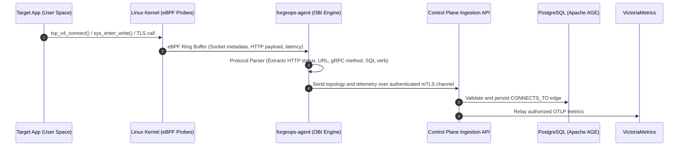

<!-- SPDX-License-Identifier: MIT -->
# Status: Superseded

This specification is retained as historical design context and is superseded by [agent-v1.3](agent-v1.3.md) for agent behavior and security boundaries. The agent-to-control-plane data path, per-process capabilities, and debugfs mount claims have been corrected from Section 17.1. Other Section 17.1 platform corrections remain open; this is not current implementation guidance.

# ForgeOps — Technical Specification v1.2

**Project:** ForgeOps  
**Category:** Self-hosted DevOps and SRE automation platform  
**Primary language:** Go  
**Primary database:** PostgreSQL (with Apache AGE property graph & pgvector vector search)  
**Preferred metrics backend:** VictoriaMetrics  
**Telemetry standard:** OpenTelemetry & OpenTelemetry eBPF Instrumentation (OBI)  
**Agent & AI interface:** Model Context Protocol (MCP) Server & Client  
**Initial deployment target:** RHEL-compatible Linux  
**Infrastructure targets:** Bare-metal Linux, Kubernetes, Docker Swarm, and hybrid environments  
**Operating principle:** Read-only discovery and evidence-based investigation by default  
**AI strategy:** Provider-neutral, local inference supported, grounded with GraphRAG  
**Status:** Implementation specification  

---

# 1. Executive Summary

## 1.1 Purpose

ForgeOps is a self-hosted infrastructure operations and site reliability engineering (SRE) platform designed to:
1. Discover heterogeneous infrastructure and build a continuously synchronized property graph topology.
2. Ingest zero-touch kernel-level telemetry and correlate multi-signal operational evidence (metrics, logs, traces, network socket flows).
3. Ground incident analysis in organizational knowledge (runbooks, historical post-mortems, GitOps configurations) using Graph-guided Retrieval-Augmented Generation (GraphRAG).
4. Provide native Model Context Protocol (MCP) interfaces to seamlessly interact with external AI agents, IDEs, and enterprise workflows.
5. Investigate production incidents and recommend auditable, human-in-the-loop (HITL) remediations without modifying infrastructure autonomously.

The platform targets organizations operating across:
* Bare-metal Linux servers and RHEL-compatible distributions (RHEL 8/9, Rocky Linux, AlmaLinux).
* Kubernetes clusters (vanilla, OpenShift, RKE2, k3s).
* Docker Swarm clusters and standalone container hosts.
* Private on-premises datacentres and air-gapped / sovereign environments.
* Hybrid architectures bridging legacy virtualization and modern container platforms.
* Existing monitoring stacks (VictoriaMetrics, Prometheus, Loki, OpenTelemetry Collectors).

ForgeOps provides the investigative capabilities of an AI-assisted operations engineer while remaining 100% self-hosted, sovereign, and free of mandatory external SaaS dependencies.

## 1.2 Core Capabilities

ForgeOps v1.2 provides:

1. **Infrastructure Discovery and Property Graph:** Continuous discovery of hosts, containers, clusters, and networks mapped into a PostgreSQL property graph powered by **Apache AGE** (openCypher) and hierarchical path indexes.
2. **OpenTelemetry eBPF Instrumentation (OBI):** Zero-code kernel-level auto-instrumentation for HTTP/gRPC/SQL RED metrics (Rate, Errors, Duration), user-space TLS inspection via uprobes without private keys, and deterministic socket-level network latency/topology mapping.
3. **Telemetry Integration:** Native querying and correlation across VictoriaMetrics, Prometheus, Loki, and OTLP-compliant tracing backends.
4. **Operational Knowledge & GraphRAG:** Vector indexing of operational runbooks, standard operating procedures (SOPs), and historical incident retrospectives using **pgvector** in PostgreSQL, coupled with topological subgraph pre-filtering (GraphRAG) to eradicate hallucinations.
5. **Model Context Protocol (MCP) Gateway:** Dual-mode MCP integration acting as an **MCP Server** (exposing tools, resources, and triage prompts to Claude, Cursor, Antigravity, and CLI agents) and an **MCP Client** (querying external tools such as GitHub, GitLab, and PagerDuty).
6. **Deterministic Incident Correlation:** Multimodal evidence collection linking alerts, topology changes, network degradation, and metric anomalies before involving AI models.
7. **AI-Assisted Investigation:** Evidence-first hypothesis generation and remediation guidance supported by explicit citations to internal runbooks and telemetry traces.
8. **Controlled Remediation:** Cryptographically auditable, human-in-the-loop remediation execution requiring explicit multi-factor authorization.
9. **Unified Interfaces:** Versioned REST API (`/api/v1`), interactive CLI (`forgeops-cli`), and standard JSON-RPC over stdio / SSE for MCP.
10. **Enterprise Deployment & Packaging:** Hardened RPM packages, non-root systemd unit configurations, and minimal Kubernetes Helm charts.

## 1.3 Architectural Principles

ForgeOps adheres strictly to the following architectural tenets:

* **Self-hosted and Sovereign First:** Core functionality must operate without external SaaS dependencies or mandatory cloud services.
* **Unified PostgreSQL Engine:** Store relational metadata, property graph topologies (Apache AGE), and dense vector embeddings (pgvector) in a single PostgreSQL cluster, eliminating operational fragmentation.
* **Zero-Code Observability (eBPF First):** Collect application performance, golden signals, and network flows directly at the Linux kernel boundary without demanding application code changes or SDK injections.
* **Read-Only Discovery by Default:** Ordinary discovery and background investigation runs must never mutate target systems or alter running configurations.
* **Evidence-Backed & Grounded AI:** AI outputs must never be treated as authoritative state. Every hypothesis must be grounded in deterministic telemetry evidence and cited runbook documentation.
* **Provider-Neutrality:** Support interchangeable backends for metrics (VictoriaMetrics/Prometheus), logs (Loki/OTel), and inference (Local Ollama/vLLM/llama.cpp or enterprise OpenAI-compatible endpoints).
* **Least Privilege & Explicit Remediation:** Remediation actions require isolated execution permissions, explicit human approval, and an immutable audit log.
* **Operational Resilience:** Failure or unreachable state in any telemetry backend, eBPF probe, or AI model must never crash the core discovery engine or control plane.

---

# 2. Scope and Non-Goals

## 2.1 Initial Scope Matrix

| Domain | Supported Capabilities in v1.2 |
| :--- | :--- |
| **Linux Host** | Bare-metal RHEL 8/9, Rocky, Alma; OS, CPU, memory, disk, network, systemd status, eBPF kernel metrics. |
| **Containers** | Docker Engine, Docker Swarm (managers, workers, services, tasks, overlay networks), standalone containers. |
| **Kubernetes** | Clusters, nodes, namespaces, workloads (Deployments, StatefulSets, DaemonSets), pods, services, ingresses, PVCs, events. |
| **Storage Engine** | PostgreSQL 16+ with **Apache AGE** (property graph / openCypher) and **pgvector** (vector embeddings / HNSW). |
| **eBPF (OBI)** | Linux kernel eBPF probes for HTTP/gRPC/SQL RED metrics, TLS uprobes, TCP socket connection tracking (`CONNECTS_TO` edges). |
| **Metrics** | VictoriaMetrics (single-node and cluster), Prometheus-compatible endpoints, OTLP metric ingestion. |
| **Logs** | Grafana Loki (LogQL queries, stream extraction), OpenTelemetry log pipelines. |
| **Traces** | OpenTelemetry OTLP trace backends (Jaeger, Tempo, VictoriaTraces). |
| **Knowledge / RAG** | Markdown runbooks, GitOps manifests, post-mortems, alert playbooks indexed into pgvector; GraphRAG topologically filtered retrieval. |
| **Agent / MCP** | Dual-mode Model Context Protocol: MCP Server (stdio & SSE) and MCP Client (GitHub, Jira, PagerDuty). |
| **Remediation** | Human-in-the-loop proposals, dry-run simulations, auditable execution approval. |
| **Interfaces** | REST API (`/api/v1`), interactive CLI, MCP stdio/SSE server. |
| **Deployment** | Native Linux RPMs/systemd services, container images, Kubernetes DaemonSets and Helm charts. |

## 2.2 Non-Goals for Initial Releases

The platform will explicitly **not**:
* Replace Kubernetes, Docker Swarm, or systemd as an orchestrator.
* Implement a proprietary time-series database engine or log storage system (leveraging VictoriaMetrics and Loki instead).
* Mandate manual OpenTelemetry SDK code modifications in application codebases (using OBI eBPF instead).
* Automatically trigger unapproved infrastructure mutations or autonomous self-healing without human confirmation.
* Expose writable Docker socket or root privileges directly to the control plane.
* Require cloud vendor APIs (AWS, Azure, GCP) to function in on-premises bare-metal setups.
* Rely on ungrounded generative AI for deterministic infrastructure state or alerting decisions.

---

# 3. System Architecture

## 3.1 High-Level Architecture

The ForgeOps platform is designed as a **modular Go monolith** for the control plane, supplemented by a lightweight host agent (`forgeops-agent`) capable of hosting eBPF probes on target nodes.

```
                             OPERATORS & AGENTS
                                     │
           ┌─────────────────────────┴────────────────────────┐
           │                                                  │
       Web UI / CLI                                  External AI Clients
      (REST / JSON)                              (Claude, Cursor, Antigravity)
           │                                                  │
           │                                       MCP Protocol (stdio/SSE)
           ▼                                                  ▼
 ┌─────────────────────────────────────────────────────────────────────────────┐
 │                           FORGEOPS CONTROL PLANE                            │
 │                                                                             │
 │  ┌───────────────────────┐ ┌───────────────────────┐ ┌───────────────────┐  │
 │  │ AuthN / AuthZ (RBAC)  │ │ Environment & Config  │ │ Audit Logger      │  │
 │  └───────────────────────┘ └───────────────────────┘ └───────────────────┘  │
 │  ┌───────────────────────┐ ┌───────────────────────┐ ┌───────────────────┐  │
 │  │ Discovery Engine      │ │ Graph Topology Engine │ │ Telemetry Service │  │
 │  │ (K8s, Swarm, Host)    │ │ (Apache AGE / Cypher) │ │ (Metrics/Logs/Tr) │  │
 │  └───────────────────────┘ └───────────────────────┘ └───────────────────┘  │
 │  ┌───────────────────────┐ ┌───────────────────────┐ ┌───────────────────┐  │
 │  │ Incident Detection &  │ │ GraphRAG Knowledge    │ │ MCP Gateway       │  │
 │  │ Evidence Correlation  │ │ Engine (pgvector)     │ │ (Server & Client) │  │
 │  └───────────────────────┘ └───────────────────────┘ └───────────────────┘  │
 │  ┌───────────────────────┐ ┌───────────────────────┐                        │
 │  │ AI Investigation      │ │ Controlled            │                        │
 │  │ (Local / Remote LLM)  │ │ Remediation (HITL)    │                        │
 │  └───────────────────────┘ └───────────────────────┘                        │
 └───────────────────────┬─────────────────────────┬───────────────────────────┘
                         │                         │
     SQL + openCypher    ▼                         ▼  OTLP / MetricsQL / LogQL
 ┌──────────────────────────────────────┐  ┌───────────────────────────────────┐
 │        POSTGRESQL UNIFIED DB         │  │       OBSERVABILITY BACKENDS      │
 │  ┌────────────────────────────────┐  │  │  ┌─────────────────────────────┐  │
 │  │ Relational Engine              │  │  │  │ VictoriaMetrics             │  │
 │  │ (Entities, Incidents, Audits)  │  │  │  │ (High-Throughput Metrics)   │  │
 │  ├────────────────────────────────┤  │  │  ├─────────────────────────────┤  │
 │  │ Apache AGE (Property Graph)    │  │  │  │ Grafana Loki                │  │
 │  │ (Nodes, Edges, Subgraphs)      │  │  │  │ (Structured Operational Logs│  │
 │  ├────────────────────────────────┤  │  │  ├─────────────────────────────┤  │
 │  │ pgvector Extension             │  │  │  │ OTel Trace Backend          │  │
 │  │ (Runbooks, SOPs, Post-Mortems) │  │  │  │ (Jaeger / Tempo)            │  │
 │  └────────────────────────────────┘  │  │  └─────────────────────────────┘  │
 └──────────────────────────────────────┘  └─────────────────▲─────────────────┘
                         ▲                                   │
                         │ Discovery Updates                 │ OTLP Telemetry
                         │                                   │
 ┌───────────────────────┴───────────────────────────────────┴─────────────────┐
 │                           DATA & TELEMETRY PLANE                            │
 │                                                                             │
 │   ┌───────────────────────────┐           ┌─────────────────────────────┐   │
 │   │ forgeops-agent (with OBI) │           │ Kubernetes Discovery & OTel │   │
 │   │ (Kernel eBPF Probes,      │           │ (API Informers,             │   │
 │   │  TLS Uprobes, Socket Map) │           │  DaemonSet Collectors)      │   │
 │   └─────────────┬─────────────┘           └──────────────┬──────────────┘   │
 │                 │                                        │                  │
 │                 ▼                                        ▼                  │
 │   Bare-Metal RHEL / Standalone Host          Production Kubernetes Clusters │
 └─────────────────────────────────────────────────────────────────────────────┘
```

## 3.2 Major Architectural Components

### 1. Control Plane (`cmd/forgeops`)
* **REST & MCP Server:** Exposes HTTP endpoints (`/api/v1`) for operators and JSON-RPC stdio/SSE endpoints for Model Context Protocol consumers.
* **Graph Topology Engine:** Translates discovery data into property graph vertices and edges stored in Apache AGE; executes openCypher traversals for blast-radius calculation.
* **Telemetry Query Service:** Provides a unified facade over VictoriaMetrics, Prometheus, Loki, and tracing systems.
* **Operational GraphRAG Engine:** Ingests documentation and post-mortems into `pgvector`; coordinates topological filtering during incident triage.
* **Incident Correlation & Investigation Engine:** Assembles multi-signal evidence bundles (metrics, logs, traces, topology changes) and generates structured diagnostic reports.
* **Remediation Guard:** Enforces human-in-the-loop review, dry-run simulation, and auditable execution of operational playbooks.

### 2. Host Agent & OBI eBPF Subsystem (`cmd/forgeops-agent`)
* Runs as a lightweight systemd service or container DaemonSet on target Linux hosts.
* Houses the **OpenTelemetry eBPF Instrumentation (OBI)** engine:
  * Attaches kernel probes (kprobes/tracepoints) to socket operations (`connect`, `accept`, `sendmsg`, `recvmsg`) to extract RED metrics and network latency.
  * Attaches user-space probes (`uprobes`) to OpenSSL, Go crypto/tls, and GnuTLS shared libraries to observe decrypted HTTP/gRPC/SQL transactions.
  * Injects `CONNECTS_TO` edge events and latency measurements into the control plane topology engine.
  * Emits standard OTLP metrics directly to VictoriaMetrics.

### 3. Unified PostgreSQL Storage
* Acts as the single operational database, eliminating the maintenance cost of running independent relational, graph, and vector database engines.
* Uses standard PostgreSQL 16+ extended with:
  * `age` (Apache AGE): Property graph vertices, edges, and openCypher queries.
  * `vector` (pgvector): High-performance vector embeddings (HNSW indexes) for RAG.
  * `ltree`: Fast hierarchical path indexing for infrastructure trees.

---

# 4. Architecture Decision Records (ADRs)

## ADR-001: Go as the Primary Implementation Language
* **Status:** Accepted
* **Context:** The system requires high concurrency, low memory overhead, straightforward cross-compilation for RHEL/Linux, native integration with the Kubernetes API machinery, and direct interoperability with eBPF libraries (Cilium's `cilium/ebpf`).
* **Decision:** ForgeOps control plane, agent, and CLI are built purely in Go (v1.23+).

## ADR-002: Modular Monolith Control Plane
* **Status:** Accepted
* **Context:** Microservice architectures introduce operational burden, network overhead, and complex deployment topologies that conflict with self-hosted bare-metal environments.
* **Decision:** The control plane is compiled as a single modular binary with strictly decoupled internal packages (`internal/graph`, `internal/telemetry`, `internal/rag`, `internal/mcp`).

## ADR-003: PostgreSQL as Unified Metadata, Graph, and Vector Storage
* **Status:** Updated & Accepted (Supercedes v1.1 ADR-003)
* **Context:** Infrastructure topology requires property graph traversals (multi-hop dependency analysis), while incident triage requires semantic document search (RAG). Operating independent databases (PostgreSQL + Neo4j + Qdrant) creates unacceptable maintenance overhead for on-premises teams.
* **Decision:** Standardize on PostgreSQL with **Apache AGE** (`age`) for openCypher property graphs and **pgvector** (`vector`) for vector embeddings. Standard relational tables handle ACID inventory, incidents, and audit logs.

## ADR-004: OpenTelemetry and eBPF (OBI) as Core Observability Standards
* **Status:** Updated & Accepted (Supercedes v1.1 ADR-004)
* **Context:** Requiring developers to modify application source code or inject language-specific SDKs prevents observability across legacy bare-metal binaries, proprietary packages, and uninstrumented containers.
* **Decision:** Adopt OpenTelemetry eBPF Instrumentation (OBI) alongside standard OTLP. OBI kernel probes capture zero-code HTTP/gRPC/SQL metrics and network connections, while traditional OTel Collectors and Prometheus endpoints remain fully supported.

## ADR-005: VictoriaMetrics as First-Class Metrics Backend
* **Status:** Accepted
* **Context:** Long-term time-series storage on modest hardware requires extreme compression, low memory footprint, and high ingestion throughput.
* **Decision:** VictoriaMetrics (single-node or cluster) is the preferred time-series storage backend, accessed via high-speed Prometheus-compatible MetricsQL/PromQL APIs and OTLP ingestion.

## ADR-006: Strictly Decoupled Telemetry Interfaces
* **Status:** Accepted
* **Context:** Heterogeneous enterprise environments use different combinations of metrics, log, and trace providers.
* **Decision:** Maintain independent Go provider interfaces for `MetricsProvider`, `LogsProvider`, and `TracesProvider`. No backend is forced to implement signals it does not support.

## ADR-007: Read-Only Discovery and Guarded Remediation
* **Status:** Accepted
* **Context:** Autonomous, unverified write actions pose catastrophic availability risks to production infrastructure.
* **Decision:** Discovery and investigation are strictly read-only. Remediation proposals require explicit operator authentication, human approval (HITL), and cryptographic audit trails.

## ADR-008: Provider-Neutral AI with Mandatory Local Inference
* **Status:** Accepted
* **Context:** Strict data privacy, air-gapped datacentres, and enterprise compliance prohibit mandatory external AI API calls.
* **Decision:** The AI engine interfaces with any OpenAI-compatible HTTP endpoint (supporting local instances like Ollama, vLLM, and llama.cpp). The platform must remain fully operational deterministically if AI is disabled.

## ADR-009: Database-Backed Asynchronous Jobs
* **Status:** Accepted
* **Context:** Introducing Kafka or RabbitMQ introduces unnecessary operational dependencies.
* **Decision:** Background discovery runs, metric sweeps, and knowledge re-indexing use PostgreSQL-backed transactional worker queues (`SKIP LOCKED`).

## ADR-010: Model Context Protocol (MCP) as a First-Class Interface
* **Status:** Accepted (Promoted from Optional in v1.1)
* **Context:** Modern SRE workflows increasingly rely on external AI assistants (Claude Desktop, Cursor, Antigravity, autonomous agents) needing structured, authenticated access to operational state.
* **Decision:** Embed a dual-mode MCP Gateway into ForgeOps. ForgeOps acts as an **MCP Server** (exposing tools, resources, and triage prompts over stdio and SSE) and an **MCP Client** (enriching investigations with data from GitHub, PagerDuty, and cloud providers).

## ADR-011: Operational RAG and GraphRAG Knowledge Engine
* **Status:** Accepted (New in v1.2)
* **Context:** Generic LLMs lack organizational context (internal runbooks, post-mortems, GitOps architectures) and hallucinate during outages. Standard vector search retrieves irrelevant documents across massive corpuses.
* **Decision:** Implement a GraphRAG engine combining topological subgraph constraints with `pgvector` dense vector search. The affected resource's topology filters retrieval candidates before vector matching.

## ADR-012: Kernel-Level Zero-Code Instrumentation via OBI eBPF
* **Status:** Accepted (New in v1.2)
* **Context:** Black-box binaries and COTS applications on RHEL hosts lack telemetry. Manual network mapping is prone to configuration staleness.
* **Decision:** Implement eBPF socket tracing and user-space TLS uprobes in `forgeops-agent`. eBPF dynamically discovers socket communication pairs to infer live `CONNECTS_TO` graph edges and measure round-trip times (RTT) without code changes.

---

# 5. Repository Structure

```text
forgeops/
├── cmd/
│   ├── forgeops/                # Main Control Plane binary
│   ├── forgeops-agent/          # Host Agent binary (incorporating eBPF / OBI)
│   ├── forgeops-mcp/            # Dedicated standalone MCP stdio/SSE server
│   └── forgeops-cli/            # Command-line administrative client
│
├── internal/
│   ├── core/                    # Core domain entities & business logic
│   │   ├── models/              # Resource, Relationship, Incident, Evidence
│   │   └── ports/               # Primary repository and service interfaces
│   │
│   ├── graph/                   # Property Graph & Topology Engine
│   │   ├── age/                 # Apache AGE openCypher implementation
│   │   ├── traverser/           # Blast-radius, pathing, and cycle algorithms
│   │   └── mapper/              # Translates discovery events to graph edges
│   │
│   ├── ebpf/                    # OpenTelemetry eBPF Instrumentation (OBI)
│   │   ├── bpf/                 # Clang/LLVM C source files for eBPF probes
│   │   ├── tracer/              # Socket lifecycle & protocol tracers (HTTP/gRPC/SQL)
│   │   ├── uprobes/             # OpenSSL, Go crypto/tls, GnuTLS uprobe hooks
│   │   └── ringbuf/             # High-performance eBPF ring-buffer reader
│   │
│   ├── rag/                     # Operational Knowledge & RAG Engine
│   │   ├── indexer/             # Git & filesystem runbook sync service
│   │   ├── chunker/             # AST-aware Markdown & code chunker
│   │   ├── embedder/            # Local (Ollama/TEI) and remote embedding clients
│   │   ├── retriever/           # Hybrid BM25 + pgvector HNSW search
│   │   └── graphrag/            # Topological subgraph filtering + context assembly
│   │
│   ├── mcp/                     # Model Context Protocol Gateway
│   │   ├── server/              # stdio & SSE MCP Server engine
│   │   ├── client/              # MCP Client manager for external servers
│   │   ├── tools/               # Handlers for forgeops_* MCP tools
│   │   ├── resources/           # Handlers for forgeops://* URIs
│   │   └── prompts/             # Standard prompt templates (e.g., incident triage)
│   │
│   ├── telemetry/               # Unified Telemetry Layer
│   │   ├── query/               # Query orchestration service
│   │   └── providers/           # Backend adapters
│   │       ├── victoriametrics/ # MetricsQL / PromQL provider
│   │       ├── prometheus/      # Standard Prometheus client
│   │       ├── loki/            # LogQL query provider
│   │       ├── traces/          # OTLP / Jaeger trace provider
│   │       └── otelcol/         # Collector integration & health checks
│   │
│   ├── adapters/                # Infrastructure Discovery Adapters
│   │   ├── host/                # Linux bare-metal (sysfs, procfs, systemd)
│   │   ├── kubernetes/          # K8s client-go API informers
│   │   ├── docker/              # Docker Engine client
│   │   └── swarm/               # Docker Swarm cluster client
│   │
│   ├── storage/                 # Persistence Layer
│   │   └── postgres/            # PostgreSQL migrations, pgx pool, queries
│   │
│   ├── investigation/           # Incident Detection & Correlation Engine
│   │   ├── detector/            # Deterministic threshold & event rules
│   │   ├── correlator/          # Cross-signal evidence assembler
│   │   └── ai/                  # LLM inference caller & report generator
│   │
│   └── remediation/             # Controlled Remediation Subsystem
│       ├── planner/             # Playbook parsing & parameter validation
│       ├── approval/            # Two-person review & cryptographic signatures
│       └── runner/              # Sandboxed, auditable execution engine
│
├── migrations/                  # PostgreSQL schema migrations (DDL + AGE + pgvector)
├── api/                         # OpenAPI v3 specifications & MCP schemas
├── configs/                     # Default YAML configurations
├── deploy/                      # Deployment manifests
│   ├── rpm/                     # Spec files for RHEL 8/9 packaging
│   ├── systemd/                 # Hardened systemd unit definitions
│   ├── containers/              # Containerfiles (multi-stage Go builds)
│   └── kubernetes/              # Helm chart & eBPF DaemonSet manifests
├── tests/                       # Unit, integration, e2e, and benchmark tests
├── Makefile                     # Build, lint, bpf-generate, and test targets
├── go.mod
└── go.sum
```

---

# 6. Core Resource Model & Graph Representation

## 6.1 Unified Resource Entity

Every discovered asset possesses a canonical representation in the relational database while simultaneously being registered as a vertex in the **Apache AGE** property graph.

```go
type Resource struct {
    ID          string                 `json:"id"`
    Environment string                 `json:"environment"`
    Kind        ResourceKind           `json:"kind"`
    Provider    string                 `json:"provider"`
    ExternalID  string                 `json:"external_id"`
    Name        string                 `json:"name"`
    Namespace   string                 `json:"namespace,omitempty"`
    Labels      map[string]string      `json:"labels"`
    Attributes  map[string]any         `json:"attributes"`
    Status      string                 `json:"status"`
    FirstSeenAt time.Time              `json:"first_seen_at"`
    LastSeenAt  time.Time              `json:"last_seen_at"`
    StaleSince  *time.Time             `json:"stale_since,omitempty"`
    Source      string                 `json:"source"`
}
```

## 6.2 Property Graph Schema (Apache AGE)

In Apache AGE, resources are represented as **Vertices** labeled by their `ResourceKind`, and relationships are represented as **Edges** labeled by their interaction type.

```
                  ┌───────────────┐
                  │ Host (Node)   │
                  └───────▲───────┘
                          │ RUNS_ON (Observed)
                  ┌───────┴───────┐
                  │      Pod      │
                  └───────▲───────┘
                          │ CONTAINS (Observed)
                  ┌───────┴───────┐
                  │   Container   │
                  └───────┬───────┘
                          │ CONNECTS_TO (eBPF Verified: RTT=1.4ms)
                          ▼
                  ┌───────────────┐
                  │ Database Host │
                  └───────────────┘
```

### Graph Edge Types:
* `RUNS_ON`: Workload execution relationship (e.g., Pod on Node, Container on Host).
* `CONTAINS`: Structural hierarchy (e.g., Cluster contains Namespace, Pod contains Container).
* `CONNECTS_TO`: Live network communication (discovered and verified via eBPF socket tracing). Contains properties: `port`, `protocol`, `rtt_ms`, `bytes_sec`, `last_observed`.
* `DEPENDS_ON`: Logical application dependency (inferred from traces or configuration).
* `EXPOSES`: Networking exposure (e.g., Service exposes Deployment, Ingress exposes Service).
* `MOUNTS`: Storage attachment (e.g., Pod mounts PersistentVolumeClaim).
* `EMITS_TELEMETRY_TO`: Telemetry pipeline edge (e.g., Host emits to VictoriaMetrics).

---

# 7. Infrastructure Discovery

## 7.1 Multi-Modal Discovery Pipeline

Discovery combines three synchronized ingestion methods:
1. **Periodic API Discovery:** Queries Kubernetes API servers, Docker daemons, and Linux OS APIs (`/proc`, `/sys`, `systemd`) on a scheduled interval (default: 5m).
2. **Real-Time Streaming Informers:** Watches Kubernetes event streams (`Pods`, `Nodes`, `Events`) for sub-second topology updates.
3. **Continuous eBPF Socket Discovery:** The agent sends real-time TCP socket connection tuples (`src_ip:src_port` $\rightarrow$ `dst_ip:dst_port`) to the control-plane ingestion API over its authenticated channel. The control plane validates and persists topology updates; agents never write directly to PostgreSQL.

## 7.2 Linux Host Discovery

The host adapter collects hardware, system, and kernel state without requiring root privileges for standard metrics:
* Machine identity, DMI product UUID, architecture, hostname.
* CPU core topology, frequency governors, CPU throttling statistics.
* Memory breakdown (total, available, dirty buffers, hugepages).
* Storage devices, partition layout, filesystem utilization, mount options.
* Network interfaces, MTU, IP addresses, bonding/bridge topology.
* Systemd service units: active state, substate, restart counters, failed units.
* Kernel version, boot parameters, and eBPF subsystem compatibility flags (BTF verification).

---

# 8. Telemetry Architecture

ForgeOps supports five comprehensive collection patterns:

```
  Pattern A: Existing Observability Stack (ForgeOps queries VM/Loki via PromQL/LogQL)
  Pattern B: Existing OpenTelemetry Collectors (Collectors export OTLP to ForgeOps)
  Pattern C: ForgeOps Managed Telemetry (Host Agent exports OTLP metrics to VM)
  Pattern D: Mixed Heterogeneous Infrastructure (K8s OTel + Bare-Metal Prometheus)
  Pattern E: Zero-Code eBPF Instrumentation (Kernel-level RED metrics and socket flows)
```

Ingestion pathways are decoupled from querying pathways:
* **Metrics Storage:** Handled by VictoriaMetrics (or Prometheus) for maximum compression and query velocity.
* **Log Storage:** Handled by Loki.
* **Trace Storage:** Handled by standard OTLP-compliant trace backends (Tempo/Jaeger).
* **Metadata & Topology:** Handled by PostgreSQL (with Apache AGE and pgvector).

---

# 9. OpenTelemetry eBPF Instrumentation (OBI)

## 9.1 Functional Overview

The integration of OpenTelemetry eBPF Instrumentation (OBI) into the `forgeops-agent` transforms ForgeOps into a zero-touch observability platform. By executing verified eBPF bytecode in the Linux kernel, ForgeOps instruments applications without touching their source code, build chains, or deployment manifests.



## 9.2 Zero-Code Protocol Parsing & RED Metrics

OBI intercepts socket and thread lifecycle events:
* **HTTP/1.1 & HTTP/2:** Automatically parses request method, URI path, status code, content length, and end-to-end execution duration.
* **gRPC:** Decodes HTTP/2 framing and extracts gRPC method names and status codes.
* **SQL:** Inspects database wire protocols (PostgreSQL frontend/backend protocol, MySQL packet format) to measure query latency and detect slow queries or connection drops without modifying database configs.
* **RED Metrics Emitted:**
  * `http.server.request.duration` (Histogram with latency buckets).
  * `http.server.requests` (Counter partitioned by HTTP status: 2xx, 4xx, 5xx).
  * `rpc.server.duration` (gRPC response times).
  * `db.client.operation.duration` (Database query execution latency).

## 9.3 Transparent HTTPS/TLS Inspection via Uprobes

Traditional eBPF socket filters only see encrypted ciphertexts when TLS is active. OBI overcomes this without requiring server private keys:
* Injects user-space probes (`uprobes` and `uretprobes`) into dynamic shared libraries:
  * `libssl.so` (OpenSSL)
  * `libcrypto.so`
  * `libgnutls.so`
  * Go binary runtime symbols (`crypto/tls.(*Conn).Write`, `crypto/tls.(*Conn).Read`)
* Probes capture plaintext payloads immediately before encryption on egress and immediately after decryption on ingress.
* Data is read safely through memory boundaries using `bpf_probe_read_user()`.

## 9.4 Dynamic Network Topology Mapping

OBI provides direct kernel ground truth for network connectivity:
* Observes `sys_enter_connect` and `inet_csk_accept`.
* Correlates kernel PID and network namespaces to known container IDs and Kubernetes pods.
* Injects dynamic `CONNECTS_TO` edges into the Apache AGE graph:
  * Measures kernel TCP round-trip time (`srtt`).
  * Counts TCP retransmissions (`retrans_out`) and socket drop events.
  * *Operational Benefit:* If a database query spikes in latency, ForgeOps immediately determines whether the bottleneck is network packet loss, kernel socket backlog, or database query execution time.

## 9.5 Kernel Requirements & Safety Guarantees

* **Kernel Compatibility:** RHEL 8 (kernel 4.18.0-305+ with eBPF compile-once run-everywhere enabled) or RHEL 9 (kernel 5.14+ with full BPF Type Format / BTF).
* **Verifier Safety:** All eBPF programs pass the kernel in-kernel verifier, preventing out-of-bounds memory access, infinite loops, and kernel panics.
* **Resource Bounds:** CPU usage of the eBPF probe worker is capped at $<2\%$ of a single core; ring-buffer drops are recorded under `forgeops_agent_ebpf_dropped_events_total`.

---

# 10. VictoriaMetrics Integration

## 10.1 Ingestion and Query Architecture

VictoriaMetrics serves as the primary time-series engine:
* **High-Throughput Ingestion:** `forgeops-agent` streams OTLP metrics directly to the VictoriaMetrics OTLP endpoint:
  ```text
  http://<victoriametrics-host>:8428/opentelemetry/v1/metrics
  ```
* **MetricsQL Query Engine:** ForgeOps leverages VictoriaMetrics extended MetricsQL functions (such as `latency_percentile`, `rate_over_time`, `rollup_changes`) for fast incident anomaly detection.
* **Query Protection:** Configurable timeouts (default: 15s), maximum query range limits (default: 7 days), and maximum series caps (default: 2,000 series per query) prevent catastrophic out-of-memory errors on large clusters.

---

# 11. Prometheus Integration

For environments with existing Prometheus installations:
* ForgeOps implements standard PromQL `/api/v1/query` and `/api/v1/query_range` clients.
* Seamlessly swaps between VictoriaMetrics and Prometheus via the common Go `MetricsProvider` interface without requiring code changes in the investigation engine.

---

# 12. Logs and Traces

## 12.1 Log Aggregation with Loki
* Queries Loki using LogQL for streaming log lines and error pattern extractions.
* Extracts high-signal logs within bounded incident windows ($\pm 15$ minutes around anomaly triggers).
* Groups and parses common structured log formats (JSON, Logfmt, systemd journal fields).

## 12.2 Distributed Tracing & W3C Trace Context
* Integrates with Jaeger, Tempo, or VictoriaTraces via OTLP.
* OBI eBPF injects W3C `traceparent` headers into uninstrumented HTTP socket calls, linking kernel socket metrics with distributed traces.

---

# 13. Telemetry Interfaces in Go

```go
package telemetry

import (
    "context"
    "time"
)

type MetricsProvider interface {
    QueryInstant(ctx context.Context, query string, at time.Time) (MetricResult, error)
    QueryRange(ctx context.Context, query string, start, end time.Time, step time.Duration) (MetricSeries, error)
    HealthCheck(ctx context.Context) error
}

type LogsProvider interface {
    QueryLogs(ctx context.Context, query LogQuery) (LogResult, error)
    HealthCheck(ctx context.Context) error
}

type TracesProvider interface {
    GetTrace(ctx context.Context, traceID string) (TraceResult, error)
    HealthCheck(ctx context.Context) error
}

type NetworkFlowProvider interface {
    StreamActiveConnections(ctx context.Context) (<-chan ConnectionEvent, error)
}
```

---

# 14. PostgreSQL Data Model (Relational, Apache AGE, and pgvector)

## 14.1 Extensions Initialization

```sql
-- Core Extensions
CREATE EXTENSION IF NOT EXISTS "uuid-ossp";
CREATE EXTENSION IF NOT EXISTS "ltree";

-- Vector Search Extension (pgvector)
CREATE EXTENSION IF NOT EXISTS "vector";

-- Property Graph Extension (Apache AGE)
CREATE EXTENSION IF NOT EXISTS "age";
LOAD 'age';
SET search_path = ag_catalog, "$user", public;

-- Initialize Property Graph Namespace
SELECT create_graph('forgeops_graph');
```

## 14.2 Relational Tables (Entities, Incidents, Auditing)

```sql
-- Environments
CREATE TABLE environments (
    id UUID PRIMARY KEY DEFAULT gen_random_uuid(),
    name VARCHAR(128) NOT NULL UNIQUE,
    description TEXT,
    environment_type VARCHAR(64) NOT NULL, -- 'production', 'staging', 'datacenter', 'hybrid'
    configuration JSONB DEFAULT '{}'::jsonb,
    created_at TIMESTAMPTZ NOT NULL DEFAULT NOW(),
    updated_at TIMESTAMPTZ NOT NULL DEFAULT NOW()
);

-- Normalized Resources Table
CREATE TABLE resources (
    id UUID PRIMARY KEY DEFAULT gen_random_uuid(),
    environment_id UUID NOT NULL REFERENCES environments(id) ON DELETE CASCADE,
    kind VARCHAR(64) NOT NULL,
    provider VARCHAR(64) NOT NULL,
    external_id TEXT NOT NULL,
    name VARCHAR(255) NOT NULL,
    namespace VARCHAR(255),
    labels JSONB DEFAULT '{}'::jsonb,
    attributes JSONB DEFAULT '{}'::jsonb,
    status VARCHAR(64) NOT NULL DEFAULT 'unknown',
    source VARCHAR(64) NOT NULL,
    hierarchy_path ltree,
    first_seen_at TIMESTAMPTZ NOT NULL DEFAULT NOW(),
    last_seen_at TIMESTAMPTZ NOT NULL DEFAULT NOW(),
    stale_since TIMESTAMPTZ,
    created_at TIMESTAMPTZ NOT NULL DEFAULT NOW(),
    updated_at TIMESTAMPTZ NOT NULL DEFAULT NOW(),
    CONSTRAINT uq_resource_identity UNIQUE (environment_id, kind, provider, external_id)
);

CREATE INDEX idx_resources_env_kind ON resources(environment_id, kind);
CREATE INDEX idx_resources_hierarchy ON resources USING GIST (hierarchy_path);
CREATE INDEX idx_resources_labels ON resources USING GIN (labels);

-- Relationships Table (Relational Backup & Temporal Tracker)
CREATE TABLE relationships (
    id UUID PRIMARY KEY DEFAULT gen_random_uuid(),
    environment_id UUID NOT NULL REFERENCES environments(id) ON DELETE CASCADE,
    source_resource_id UUID NOT NULL REFERENCES resources(id) ON DELETE CASCADE,
    target_resource_id UUID NOT NULL REFERENCES resources(id) ON DELETE CASCADE,
    relationship_type VARCHAR(64) NOT NULL,
    confidence FLOAT NOT NULL DEFAULT 1.0,
    evidence_source VARCHAR(64) NOT NULL, -- 'k8s_api', 'ebpf_socket', 'static_config'
    valid_from TIMESTAMPTZ NOT NULL DEFAULT NOW(),
    valid_to TIMESTAMPTZ,
    weight FLOAT DEFAULT 1.0, -- e.g., network latency RTT ms
    attributes JSONB DEFAULT '{}'::jsonb,
    created_at TIMESTAMPTZ NOT NULL DEFAULT NOW()
);

CREATE INDEX idx_relationships_active ON relationships (source_resource_id, target_resource_id)
WHERE valid_to IS NULL;

-- Incidents
CREATE TABLE incidents (
    id UUID PRIMARY KEY DEFAULT gen_random_uuid(),
    environment_id UUID NOT NULL REFERENCES environments(id) ON DELETE CASCADE,
    title VARCHAR(255) NOT NULL,
    description TEXT,
    severity VARCHAR(32) NOT NULL, -- 'critical', 'high', 'medium', 'low'
    status VARCHAR(32) NOT NULL DEFAULT 'open', -- 'open', 'investigating', 'mitigated', 'resolved', 'closed'
    source VARCHAR(64) NOT NULL,
    primary_resource_id UUID REFERENCES resources(id),
    detected_at TIMESTAMPTZ NOT NULL DEFAULT NOW(),
    resolved_at TIMESTAMPTZ,
    attributes JSONB DEFAULT '{}'::jsonb
);

-- Investigation Records
CREATE TABLE investigations (
    id UUID PRIMARY KEY DEFAULT gen_random_uuid(),
    incident_id UUID NOT NULL REFERENCES incidents(id) ON DELETE CASCADE,
    status VARCHAR(32) NOT NULL, -- 'running', 'completed', 'failed'
    started_at TIMESTAMPTZ NOT NULL DEFAULT NOW(),
    completed_at TIMESTAMPTZ,
    hypotheses JSONB DEFAULT '[]'::jsonb,
    evidence_bundle JSONB DEFAULT '{}'::jsonb,
    summary TEXT,
    confidence FLOAT,
    model_metadata JSONB DEFAULT '{}'::jsonb
);

-- Remediation Proposals
CREATE TABLE remediations (
    id UUID PRIMARY KEY DEFAULT gen_random_uuid(),
    investigation_id UUID NOT NULL REFERENCES investigations(id) ON DELETE CASCADE,
    title VARCHAR(255) NOT NULL,
    action_type VARCHAR(64) NOT NULL, -- 'restart_pod', 'scale_deployment', 'drain_node', 'clear_cache'
    parameters JSONB NOT NULL DEFAULT '{}'::jsonb,
    status VARCHAR(32) NOT NULL DEFAULT 'pending_approval', -- 'pending_approval', 'approved', 'executed', 'rejected'
    approved_by VARCHAR(128),
    approved_at TIMESTAMPTZ,
    executed_at TIMESTAMPTZ,
    execution_result JSONB DEFAULT '{}'::jsonb
);

-- Audit Events Table
CREATE TABLE audit_events (
    id UUID PRIMARY KEY DEFAULT gen_random_uuid(),
    actor VARCHAR(128) NOT NULL,
    action VARCHAR(128) NOT NULL,
    resource_type VARCHAR(64) NOT NULL,
    resource_id VARCHAR(128) NOT NULL,
    outcome VARCHAR(32) NOT NULL, -- 'success', 'failure', 'denied'
    details JSONB DEFAULT '{}'::jsonb,
    timestamp TIMESTAMPTZ NOT NULL DEFAULT NOW()
);
```

## 14.3 Property Graph Tables & openCypher Schema (Apache AGE)

Vertices and Edges created in `forgeops_graph`:

```sql
-- Sample openCypher: Create a Host node and a Pod node
SELECT * FROM cypher('forgeops_graph', $$
    CREATE (h:Host {id: 'host-rhel9-01', name: 'srv-prod-worker-01', ip: '10.0.1.15'})
    CREATE (p:Pod {id: 'pod-billing-78fa', name: 'billing-service-78fa', namespace: 'prod'})
    CREATE (p)-[:RUNS_ON {discovered_at: timestamp()}]->(h)
$$) as (v agtype);

-- Sample openCypher: Blast-radius query (Find all dependent services within 3 hops of a degraded node)
SELECT * FROM cypher('forgeops_graph', $$
    MATCH (h:Host {name: 'srv-prod-worker-01'})<-[:RUNS_ON]-(p:Pod)-[:CONNECTS_TO*1..3]->(target)
    RETURN p.name, target.name
$$) as (affected_pod agtype, downstream_dependency agtype);
```

## 14.4 Operational Knowledge & RAG Tables (pgvector)

```sql
CREATE TABLE knowledge_documents (
    id UUID PRIMARY KEY DEFAULT gen_random_uuid(),
    source_type VARCHAR(32) NOT NULL, -- 'runbook', 'postmortem', 'alert_doc', 'gitops_manifest'
    title VARCHAR(255) NOT NULL,
    path_or_url TEXT NOT NULL,
    content TEXT NOT NULL,
    metadata JSONB DEFAULT '{}'::jsonb, -- contains target_kinds, services, namespaces
    embedding vector(768), -- standard embedding dimension for local bge-base or nomic-embed models
    created_at TIMESTAMPTZ NOT NULL DEFAULT NOW(),
    updated_at TIMESTAMPTZ NOT NULL DEFAULT NOW()
);

-- Hierarchical Navigable Small World (HNSW) Index for Sub-Millisecond Cosine Vector Search
CREATE INDEX idx_knowledge_embeddings ON knowledge_documents 
USING hnsw (embedding vector_cosine_ops) 
WITH (m = 16, ef_construction = 64);

-- Full-Text Lexical Search Index for Hybrid Search (BM25 + Dense Vector)
CREATE INDEX idx_knowledge_fts ON knowledge_documents 
USING GIN (to_tsvector('english', title || ' ' || content));
```

---

# 15. Configuration

The example port plan is:

| Service | Port | Notes |
| --- | ---: | --- |
| Control plane | 8080 | API and local health endpoints |
| Embedding service | 8081 | Local TEI-compatible endpoint |
| MCP SSE | 8082 | Planned separate listener; startup integration remains pending |

```yaml
server:
  listen_address: "0.0.0.0:8080"
  tls:
    enabled: true
    cert_file: "/etc/forgeops/pki/server.crt"
    key_file: "/etc/forgeops/pki/server.key"

database:
  dsn_secret_ref: "forgeops/postgres-dsn"
  max_open_connections: 25
  max_idle_connections: 5
  extensions:
    age:
      enabled: true
      graph_name: "forgeops_graph"
    vector:
      enabled: true
      embedding_dimension: 768

discovery:
  interval: 5m
  adapters:
    host:
      enabled: true
    kubernetes:
      enabled: true
      in_cluster: true
    docker_swarm:
      enabled: false

ebpf:
  enabled: true
  export_metrics: true
  otlp_metrics_endpoint: "http://127.0.0.1:8428/opentelemetry/v1/metrics"
  monitor_tls: true
  capture_sql: true
  ring_buffer_pages: 64

telemetry:
  metrics:
    provider: victoriametrics
    victoriametrics:
      query_endpoint: "http://vm-single.internal:8428"
      query_timeout: 15s
      max_series: 2000
  logs:
    provider: loki
    loki:
      query_endpoint: "http://loki.internal:3100"
      query_timeout: 15s
  traces:
    provider: otel
    otel:
      endpoint: "http://tempo.internal:4317"

rag:
  enabled: true
  embedding_provider: local_tei # Text Embeddings Inference / Ollama
  embedding_endpoint: "http://127.0.0.1:8081/embed"
  top_k: 4
  similarity_threshold: 0.72
  sources:
    - path: "/var/lib/forgeops/runbooks"
      type: "runbook"
    - path: "/var/lib/forgeops/postmortems"
      type: "postmortem"

mcp:
  server:
    enabled: true
    transports:
      stdio: false
      sse:
        enabled: true
        port: 8082
        auth_token_secret_ref: "forgeops/mcp-token"
  client:
    enabled: true
    servers:
      - name: "github"
        command: "npx"
        args: ["-y", "@modelcontextprotocol/server-github"]
        env:
          GITHUB_PERSONAL_ACCESS_TOKEN_REF: "forgeops/github-token"

ai:
  enabled: true
  provider: local_openai_compatible
  endpoint: "http://127.0.0.1:11434/v1" # Ollama / vLLM
  model: "qwen2.5-coder:14b"
  request_timeout: 60s
  max_context_tokens: 16384

security:
  remediation:
    enabled: false
    require_two_person_approval: true
```

---

# 16. REST API & Model Context Protocol (MCP) Interface

## 16.1 REST API Core Endpoints (`/api/v1`)

* **Topology & Graph:**
  * `GET /api/v1/topology/subgraph?resource_id={id}&hops=2`: Returns node and edge adjacency list.
  * `POST /api/v1/topology/cypher`: Executes authenticated read-only openCypher queries against Apache AGE.
* **Resources & Discovery:**
  * `GET /api/v1/resources` & `GET /api/v1/resources/{id}`
  * `POST /api/v1/discovery/runs` & `GET /api/v1/discovery/runs/{id}`
* **Telemetry Queries:**
  * `POST /api/v1/telemetry/metrics/query` (PromQL/MetricsQL)
  * `POST /api/v1/telemetry/logs/query` (LogQL)
* **Incidents & Investigations:**
  * `GET /api/v1/incidents` & `POST /api/v1/incidents`
  * `POST /api/v1/incidents/{id}/investigate`
  * `GET /api/v1/investigations/{id}`
* **Knowledge & RAG:**
  * `POST /api/v1/knowledge/search`: Vector & hybrid search over runbooks.
  * `POST /api/v1/knowledge/reindex`: Re-indexes Git/local runbook markdown directories.
* **Controlled Remediation:**
  * `GET /api/v1/remediations`
  * `POST /api/v1/remediations/{id}/approve`
  * `POST /api/v1/remediations/{id}/execute`

## 16.2 Model Context Protocol (MCP) Server Specification

ForgeOps embeds an **MCP Server** that exposes operational state directly to AI agents via JSON-RPC over `stdio` (CLI) and `SSE` (Network).

### 1. Exposed MCP Resources
* `forgeops://environments/{env}/topology`: Live property graph topology of an environment.
* `forgeops://incidents/{id}/evidence`: The full deterministic evidence bundle (metrics, logs, traces, topology changes) collected for an incident.
* `forgeops://resources/{id}/health`: Live health and eBPF socket metrics for a specific node or container.
* `forgeops://runbooks/{slug}`: Content of verified operational runbooks.

### 2. Exposed MCP Tools
| Tool Identifier | Access Level | Purpose |
| :--- | :--- | :--- |
| `forgeops_get_topology` | Read-only | Query subgraphs around a resource up to $N$ hops using openCypher. |
| `forgeops_query_metrics` | Read-only | Execute bounded instant or range PromQL/MetricsQL queries against VictoriaMetrics. |
| `forgeops_query_logs` | Read-only | Search structured operational logs in Loki within an incident window. |
| `forgeops_search_knowledge` | Read-only | Perform GraphRAG vector searches over internal runbooks and historical post-mortems. |
| `forgeops_get_incident_evidence`| Read-only | Retrieve all correlated telemetry and events for an active incident. |
| `forgeops_propose_remediation` | Restricted | Create a draft remediation proposal requiring human operator approval. **Does not execute changes directly.** |

### 3. Exposed MCP Prompts
* `triage_incident(incident_id)`: Assembles the target resource subgraph, active anomalies, log errors, and top-matching runbook steps into a zero-shot prompt optimized for SRE root-cause diagnosis.

---

# 17. Discovery, Graph, and Telemetry Correlation

## 17.1 Multimodal Correlation Sequence

```
 1. Alert Trigger Received (e.g. HTTP 504 surge on Payment Service)
                          │
                          ▼
 2. Graph Traversal (Apache AGE openCypher)
    - Identify Pods hosting Payment Service
    - Identify Host Node running Pods: srv-prod-worker-01
    - Identify Network Neighbors via eBPF CONNECTS_TO edges (Database, Redis)
                          │
                          ▼
 3. Zero-Touch Kernel Telemetry Sweep (OBI eBPF & VictoriaMetrics)
    - Query socket RTT and TCP retransmits between Payment Service and Database
    - Check Node CPU runqueue latency and memory pressure
                          │
                          ▼
 4. Log Pattern & Trace Extraction (Loki & OTel)
    - Pull 5xx error logs and matching trace spans within the incident window
                          │
                          ▼
 5. Deterministic Baseline Comparison
    - Compare current latency with 7-day historical baseline
                          │
                          ▼
 6. Evidence Bundle Assembled & Handed to GraphRAG
```

---

# 18. Incident Detection

Incident detection operates deterministically before AI analysis:
* **eBPF Anomaly Triggers:** Sudden spikes in TCP retransmissions, socket connect errors, or protocol-level HTTP 5xx responses.
* **System Metrics Violations:** Saturation of CPU, disk I/O wait times, or memory exhaustion.
* **Kubernetes Lifecycle Events:** Pod `OOMKilled`, `CrashLoopBackOff`, node `NotReady` transitions.
* **Alert Deduplication:** Groups events within a sliding 10-minute window matching on `(environment_id, resource_subgraph)`.

---

# 19. AI-Assisted Investigation & GraphRAG

## 19.1 The GraphRAG Operational Architecture

Standard RAG searches for keywords or semantic similarity across an entire unstructured document database, frequently returning runbooks for the wrong service or environment. **GraphRAG** in ForgeOps solves this:

```mermaid
flowchart LR
    Incident[Active Incident] --> Subgraph[Extract Topology Subgraph\nvia Apache AGE]
    Subgraph --> Tags[Extract Entities:\nService, Host, Namespace]
    Tags --> Filter[Topological Metadata Filter]
    Filter --> VectorStore[(PostgreSQL\npgvector)]
    VectorStore --> MatchedDocs[Service-Specific Runbooks\n& Past Post-Mortems]
    MatchedDocs --> Context[Grounded Investigation Context]
    Context --> LLM[Local / Sovereign LLM]
    LLM --> Report[Evidence-Backed Report\nwith Citations]
```



1. **Topology Extraction:** When an incident triggers on a resource, the graph engine retrieves the 1-hop and 2-hop neighbor subgraph.
2. **Metadata Filtering:** The entities (e.g. `k8s_deployment: payment-api`, `database: postgres-core`) become mandatory SQL `WHERE` constraints on the `knowledge_documents` table.
3. **Dense Vector Search:** High-similarity runbook chunks and historical post-mortems for those exact services are retrieved using `pgvector` HNSW index.
4. **Context Assembly:** The LLM receives:
   * Deterministic metrics and eBPF socket evidence.
   * Correlated log lines and traces.
   * Ground truth runbook procedures and previous incident resolutions.
5. **Citations:** All generated suggestions include verifiable markdown references (`[Runbook: runbooks/payments/db_timeout.md#resolution]`).

---

# 20. Security Requirements

* **Non-Root Execution:** Control plane and agent run as non-root systemd service users (`forgeops`).
* **eBPF Kernel Capabilities:** Capabilities are assigned per process, not to the whole agent. The supervisor runs with no capabilities; the eBPF worker receives only the capabilities required by its enabled probes (including `CAP_BPF` and `CAP_PERFMON` where supported, and `CAP_NET_ADMIN` or `CAP_SYS_PTRACE` only where required). The discovery and actuator workers have separate privilege sets. Kernel-version exceptions and SELinux policy are defined in [agent-v1.3](agent-v1.3.md).
* **Zero Credential Exposure in eBPF:** TLS uprobes discard memory buffers outside HTTP/gRPC/SQL headers and never record TLS master keys or authentication tokens.
* **Immutable Audit Trail:** All API, CLI, and MCP tool invocations are logged to the `audit_events` table with actor identity, IP, and outcome.
* **Human-in-the-Loop Remediation:** Remediation execution requires two-person rule approval or explicit token confirmation; autonomous remediation is disabled by default.

---

# 21. Observability of ForgeOps Itself

ForgeOps instruments itself using its own standards:
* **Prometheus Metrics:** Exposes internal metrics at `:8080/metrics` (Go runtime, DB pool stats, discovery durations, eBPF event rates, MCP tool latency).
* **OpenTelemetry Self-Tracing:** Generates trace spans for discovery runs, graph queries, and RAG vector searches.
* **Health Endpoints:** `/healthz` (liveness), `/readyz` (PostgreSQL, VictoriaMetrics, and Loki connectivity).

---

# 22. Deployment and Packaging

## 22.1 RHEL-Compatible RPM Deployment
* RPM packages provided for RHEL 8/9, Rocky Linux, and AlmaLinux.
* Systemd service files:
  * `/usr/lib/systemd/system/forgeops.service`
  * `/usr/lib/systemd/system/forgeops-agent.service`

## 22.2 Kubernetes Deployment
* Helm chart deploying:
  * `forgeops-control-plane` (Deployment, 2 replicas).
  * `forgeops-agent` (DaemonSet with only the read-only host paths and capabilities required by [agent-v1.3](agent-v1.3.md); do not mount `/sys/kernel/debug` by default).

---

# 23. Performance and Reliability

* **Database Engine:** PostgreSQL tuned with `shared_buffers = 25% RAM`, `work_mem = 64MB`, `maintenance_work_mem = 512MB` for fast HNSW index builds.
* **eBPF Probe Throughput:** Agent ring buffers sized to sustain 100,000 socket events/second with $<1.5\%$ CPU overhead.
* **Memory Bounds:** Control plane memory capped at 512MB RSS in standard mode; agent capped at 128MB RSS.

---

# 24. Testing Strategy

* **Unit Tests:** Full unit test coverage across Go models, configuration parsers, and query formatters.
* **eBPF Integration Tests:** Tested against Linux kernel testing frameworks (`vmtest` / QEMU) validating probe attachment on kernels 4.18, 5.14, and 6.x.
* **Graph & AGE Tests:** Automated test suites verifying openCypher query correctness, path finding, and cycle prevention.
* **pgvector Search Quality:** Retrieval benchmarks assessing Recall@K and MRR on operational runbook fixtures.
* **MCP Compliance:** Automated test suite validating JSON-RPC protocol adherence, tool argument schemas, and RBAC enforcement.

---

# 25. Implementation Roadmap

```
 ┌─────────────────────────────────────────────────────────────────────────────┐
 │ M0: Requirements, DDL Schema & Core Interfaces (Complete)                  │
 ├─────────────────────────────────────────────────────────────────────────────┤
 │ M1: Go Modular Monolith Foundation, REST API, & AuthN/AuthZ                │
 ├─────────────────────────────────────────────────────────────────────────────┤
 │ M2: Resource Inventory & PostgreSQL Storage                                 │
 │ M2b: Apache AGE Property Graph Integration & openCypher Traversals         │
 ├─────────────────────────────────────────────────────────────────────────────┤
 │ M3: Kubernetes API Informers & Linux Host Discovery                         │
 ├─────────────────────────────────────────────────────────────────────────────┤
 │ M4: Telemetry Foundation (VictoriaMetrics, Prometheus, Loki)                │
 │ M4b: OpenTelemetry eBPF Instrumentation (OBI) in forgeops-agent            │
 ├─────────────────────────────────────────────────────────────────────────────┤
 │ M5: Multi-Signal Evidence Correlation & Baseline Comparison                 │
 ├─────────────────────────────────────────────────────────────────────────────┤
 │ M6: Operational RAG Engine (pgvector) & Markdown Runbook Indexer            │
 │ M6b: GraphRAG Topological Pre-Filtering                                     │
 ├─────────────────────────────────────────────────────────────────────────────┤
 │ M7: Model Context Protocol (MCP) Server (stdio & SSE) & Client Gateway     │
 ├─────────────────────────────────────────────────────────────────────────────┤
 │ M8: AI-Assisted Investigation Engine (Local / Remote LLMs with Citations)  │
 ├─────────────────────────────────────────────────────────────────────────────┤
 │ M9: Controlled Human-in-the-Loop Remediation Engine                         │
 ├─────────────────────────────────────────────────────────────────────────────┤
 │ M10: CLI (`forgeops-cli`) & Administrative Dashboards                       │
 ├─────────────────────────────────────────────────────────────────────────────┤
 │ M11: RPM Packaging & systemd Hardening for RHEL 8/9                         │
 ├─────────────────────────────────────────────────────────────────────────────┤
 │ M12: Production Hardening, Chaos Testing & Sovereign Deployment Validation │
 └─────────────────────────────────────────────────────────────────────────────┘
```

---

# 26. Initial Release Acceptance Criteria

The release is certified production-ready when:
1. It deploys cleanly as a non-root systemd service on RHEL 8 and RHEL 9.
2. PostgreSQL 16 successfully executes hybrid relational, openCypher (Apache AGE), and vector (pgvector) queries.
3. The agent attaches only policy-enabled eBPF probes and sends redacted telemetry and topology observations over its authenticated channel; the control plane validates observations and owns all PostgreSQL writes.
4. Queries against VictoriaMetrics and Loki retrieve telemetry evidence within $<500\text{ms}$.
5. GraphRAG accurately retrieves runbooks specific to the affected service's subgraph with cosine similarity $\ge 0.72$.
6. External AI assistants (Claude, Cursor, Antigravity) successfully connect via MCP stdio/SSE to inspect topology and run queries.
7. AI reports cite verified runbook sections and separate deterministic facts from hypotheses.
8. Zero infrastructure changes occur without explicit human-in-the-loop cryptographic authorization.

---

# 27. Key Risks and Mitigations

| Identified Risk | Impact | Architectural Mitigation |
| :--- | :--- | :--- |
| **eBPF Kernel Compatibility** | Older kernels may lack BTF or specific helper functions. | Fall back automatically to `/proc` and existing Prometheus exporters if kernel $< 4.18$. |
| **PostgreSQL Extension Availability** | Installing `age` and `vector` in locked-down environments. | Provide pre-compiled RPMs for PostgreSQL 16 on RHEL; maintain `ltree` as fallback. |
| **Vector Index Build Overhead** | High memory/CPU during large document embeddings. | Run HNSW index builds in background transactional worker tasks with `maintenance_work_mem` limits. |
| **LLM Operational Hallucination** | Recommending destructive or non-existent troubleshooting steps. | GraphRAG topological pre-filtering, mandatory runbook citations, and strict read-only default permissions. |
| **MCP Tool Overprivilege** | Agentic tools executing unauthorized infrastructure changes. | Air-gap the remediation tools; MCP server exposes only read-only tools and proposal drafting (no execution). |

---

# 28. Final Architectural Decisions Summary

1. **Language:** Go 1.27+ modular monolith. (Historical specification; superseded for current design.)
2. **Unified Data Layer:** PostgreSQL 16+ combining Relational ACID + **Apache AGE** (property graph) + **pgvector** (vector embeddings).
3. **Observability Standards:** OpenTelemetry OTLP + **OpenTelemetry eBPF Instrumentation (OBI)** for zero-code kernel metrics and socket mapping.
4. **High-Velocity Telemetry:** VictoriaMetrics (Metrics) and Loki (Logs).
5. **Agent & AI Interface:** **Model Context Protocol (MCP)** Server (stdio/SSE) and Client gateway.
6. **AI Grounding:** **GraphRAG** (topological subgraph pre-filtering + dense vector search over runbooks and post-mortems).
7. **Remediation:** Strict human-in-the-loop (HITL) approval with cryptographically signed audit records.

---

# 29. Recommended Next Steps

1. **Repository Setup:** Initialize the Go module (`go mod init github.com/forgeops/forgeops`) and create the updated directory structure.
2. **Database Provisioning:** Deploy a PostgreSQL 16 container/instance with `age` and `vector` installed; run initial migrations from Section 14.
3. **M1 & M2b Sprint:** Implement the core Go models and Apache AGE graph mapper to discover and persist a Linux host and its topology.
4. **Prototype OBI eBPF Probe:** Validate kernel probe attachment and socket RTT extraction on target RHEL 8/9 test environments.
